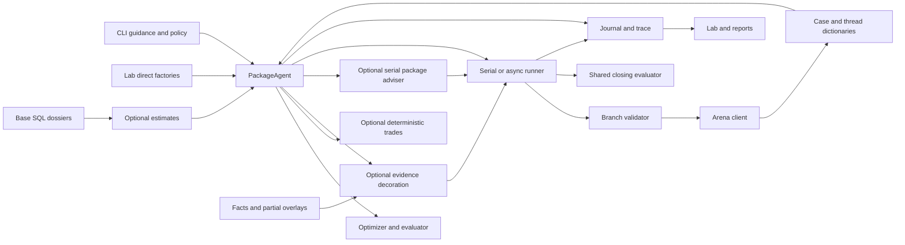

# A — Current architecture assessment and V2 migration map

**Status:** planning evidence, 10 October 2026. Inspecting `4c905b10be1f576de9b68be9c120cf6796ae4561`, not the main snapshot in document 18. [Plan and tracker](../21-negotiation-v2-plan-2026-10-10.md).

## 1. What is operational

The custom buyer is primarily deterministic. [PackageAgent](../../src/negotiator/agent.py) owns schedule, package memory, finals, evidence activation, estimator loading, and optional advice. `decide()` orchestrates serial thread choice; `propose()` provides thread proposals and reconstructs some memory. `_offer()` renders and logs before transmission and mutates `prev`; `_final_counter()` increments counters before acknowledgement. Those methods couple proposal generation to strategic state and observability.

[evaluator.py](../../src/negotiator/evaluator.py) provides `eligible_sheets`, `best_close`, `close_decision`, `supplier_for`, `price_for_cost`, and `revealed_deltas`. Complete arithmetic comes from official `arena_kit.cost`. Standing first sheets can be accepted; other sheets become counteroffer candidates. [optimizer.py](../../src/negotiator/optimizer.py) enumerates non-price options via `best_terms`. It does not model supplier acceptance. `plan` and `meso` are stubs, distinct from working payment variants in PackageAgent.

[EvidenceContext](../../src/negotiator/context.py) records relevant facts, source hashes, verified claim candidates, classifier signals and gaps. It is mutable and its `build_context` recursively hashes package files during construction. [EvidencePolicy](../../src/negotiator/evidence.py) decorates an already-generated offer, restricts eligible cases, and reserves IDs before a successful send. [claims.py](../../src/negotiator/claims.py) implements canonical rendering/checks, index windows, scorecard scope, notice scope, and disclosure rules. Evidence is usually not an input to baseline price/package strategy. Supplier-returned `claim_results` do not update selection.

[dossiers.py](../../src/negotiator/dossiers.py) uses base SQL for many attributes and should-cost estimates, with partial news/doc overlays. `_cost_row` does not give an existing case cost ID precedence over SQLite. Traits are regex-derived hypotheses; they are not known valuations. The estimator selects the first part, makes rate/margin assumptions, and exposes a range without live scenario optimization.

[PackageAdvisor](../../src/negotiator/package_advisor.py) is a functioning optional serial selector. `approved_packages` creates bounded one-field legal variants, applies a buyer-cost ceiling, and excludes previously sent packages. The model returns an ID and exact quote; code rechecks it and emits a template. It is not a general supplier interpreter or strategic memory system. Its timeout helper uses daemon threads that can outlive local waiting. [writer.py](../../src/negotiator/writer.py), [beliefs.py](../../src/negotiator/beliefs.py), and `policy.next_move` are unimplemented and have no normal execution path.

[play.py](../../src/negotiator/play.py) supplies custom serial closing and calls the new branch validator. Ordinary serial uses official `RemoteTable`/client; it is not a durable resumable decision system. [CaseRunner](../../src/negotiator/runner.py) has async tasks, journals, reconciliation, watchdog and closing. It accesses agent internals (`trades`, estimates, adviser capability), holds a lock over awaited proposal generation, and handles thread proposals and global economic closing in the same runtime module.

[state.py](../../src/negotiator/state.py) has fsynced JSONL operation intents and mutable runtime state. It preserves `unresolved` intents on this branch and repairs torn trailing journal records. It is not a versioned persistent strategic event store. [trace.py](../../src/negotiator/trace.py) is append-only diagnostic JSONL, not transactional state; [report.py](../../src/negotiator/report.py) follows `decision` events rather than one final acknowledged-action record.

The [Lab](../../src/negotiator/lab) is substantial implemented infrastructure: strict run/attempt records, checkpoints, data fingerprints, campaign leases/budget gates, stores, comparison, reconciliation, publication buffering, and UI. `lab.runner.agent_factory` constructs PackageAgent directly; `lab.worker.execute` hardcodes it; `lab.checkpoints.resolve_config` accepts a narrower set of settings. They do not automatically reproduce normal CLI guidance and adviser activation. The Lab dashboard deployment is separate from buyer execution and inference.

## 2. Actual flow and coupling



Important seams to replace:

| Coupling | Consequence | V2 boundary |
|---|---|---|
| `PackageAgent` mutates memory while proposing | Failed/unsent moves can affect next choice | Pure decision inputs; attempted-state changes only from committed/acknowledged events |
| Evidence/estimates use different data access paths | Same cost/source can mean different things | One layered typed resolver; projections for claims and estimates |
| Runtime discovers features using agent attributes | Launch path alters feature availability | Resolved capabilities and `DecisionEngine` contract |
| Model choice occurs after ordinary offer logging | Reports show an earlier candidate | Final rendered payload and economics linked to decision and operation IDs |
| Closing arithmetic assumes helper behavior and weak outgoing checks | Current standing ID alone does not prove legality | Independent economic service and final validator |
| State is a mix of dictionaries, timers and agent fields | Restart loses refusal/hold/challenge context | Server projection plus durable strategic events |
| Advisory calls use environment and internal caches | Config/cancellation/comparability differ | Injected model gateway, explicit prompt/config version and call budget |

## 3. Current-to-V2 component migration map

“Reuse” means retain a tested implementation behind a new contract, not assume every caller is safe. No code moves are part of this plan.

| Existing component / symbols | Decision | Target | Justification and required adaptation |
|---|---|---|---|
| Official `cost_breakdown`, `total_cost`, `closing_terms`, `must_haves_ok` | Retain and wrap | `v2/economics/official.py` | Scoring arithmetic remains pinned; validate inputs, retain per-component results and scenario provenance |
| Official `complete_offer`, `snap` | Restricted use | `v2/economics/candidates.py` | Useful for trusted construction only; never silently repair supplier/model output |
| `optimizer.best_terms` enumeration | Extract algorithm | `v2/economics/candidates.py` | Finite combinations are useful; bound cardinality, legal standards exception, explicit infeasibility and deterministic ties |
| `evaluator.price_for_cost` | Replace dependency | `v2/economics/prices.py` | Ordinary rounded-cost regression and unreliable relationship roots; initial relationship candidates use a bounded tick set with final certification |
| `eligible_sheets`, `best_close`, `close_decision` | Extract policy and strengthen | `v2/economics/closing.py` | One close comparison is sound; add complete legality, recipient/session ownership, fresh snapshot, typed no-alternative and estimate scenarios |
| `supplier_for` quote merge | Retain behavior and test | `v2/economics/estimates.py` | Current quote fields override master estimates; standards provenance and partial fields remain explicit |
| `revealed_deltas` | Extract observation primitive | `v2/intelligence/feedback.py` | One-field observations useful; multi-field changes stay combined; do not infer causal valuation or willingness |
| `claims.Claim`, `render`, `check`, `verify`, `claim_keys` | Wrap, then adapt resolver | `v2/evidence/claims.py` | Canonical checks useful; remove duplicate SQL/first-part joins, share basis/scope, support durable usage ledger |
| `claims.pick`, `EvidencePolicy.eligible/enrich` | Replace orchestration | `v2/evidence/claims.py` and strategy | Optional claims can affect intent selection; retain conservative disclosure, avoid premature usage consumption |
| `context.build_context`, hashes/gaps | Retain concepts; replace model and hot-path hashing | `v2/evidence/context.py`, `prepare.py` | Layered immutable snapshot, prebuilt indexes, typed conflict/freshness and part scope |
| `DataPackage`, official PDF/XLSX readers | Retain and wrap | `v2/adapters/data.py`, evidence documents | Preserve bytes/parse provenance; explicit roots/releases, SQL overlay limitations, formula strings not recalculated |
| `dossiers._cost_row`, `supplier_estimate`, `for_case` | Replace resolver; reuse documented calculations selectively | Evidence resolver + estimate service | Fix precedence, scope, case letters/news replacement and uncertainty; do not export legacy dossiers as truth |
| `traits.classify/evidence` | Optional legacy feature extractor | Interpreter deterministic fallback | Keep source links and label hypotheses; no automatic trait-to-contract binding |
| PackageAgent schedule | Preserve V1; extract pure baseline when needed | `v2/strategy/baseline.py` | Comparable deterministic fallback; do not call stateful internals from V2 strategy modules |
| `TradePolicy` | Keep V1; port isolated tested rules later | `v2/strategy/capacity.py` initially | No expansion of V1 conditional tree; new strategy emits typed intents |
| `PackageAdvisor` schema/ID/quote pattern | Reuse design; replace implementation coupling | Interpreter/selector + model adapter | Grounded structured outputs and ID choice useful; inject async cancellable gateway, persist assessments, separate interpreting from selecting |
| `writer`, `beliefs`, `next_move`, `optimizer.plan/meso` stubs | Leave V1 files; do not build on them | Explicit new modules | Their docstrings are not implemented capabilities |
| `guards.check`, `leaks` | Replace validator; retain leak patterns as supplemental checks | `v2/execution/validation.py` | Present branch check lacks full completeness/disclosure/replay/recipient coverage and has incorrect prose limits |
| `play_case`, `CaseRunner` | Retain V1; replace orchestration for V2 | `v2/orchestration/loop.py` | A new small serial coordinator avoids importing faulty worker lifecycle; shared gateway/validator must also serve adapted V1 |
| `AsyncArena`, official client and `JournaledArena` | Wrap transport primitives, replace operation lifecycle | `v2/adapters/arena.py`, execution/recovery | Endpoint allowlist, total budgets, exact idempotent bytes, truthful outcome classification; async HTTP may be used with serial scheduling |
| `Journal`, torn-tail repair | Retain legacy import/read compatibility | `v2/adapters/legacy.py`, `sqlite.py` | New atomic state/outbox needs SQLite; legacy files remain intact and imported uncertainty requires reconciliation |
| `Tracer`, report loaders | Retain format readers; extend export | V2 event/trace projection, Lab | Link actual payload through operation and outcome; session/attempt join and complete-run metrics |
| `RuntimeGuidance`, `PolicyConfig`, `run_config` | V1 inputs to one explicit resolver | `v2/config.py`, common factory | Freeze effective config before opening; V2 settings do not silently inherit V1 environment |
| Lab stores/checkpoints/campaign/policy/UI | Retain infrastructure; extend schemas/factory/reports | Existing Lab + V2 trace adapter | Immutable source/data and gates useful; do not rebuild dashboard, bypass budgets or retroactively relabel old arms |
| Tests, local simulator, practice cases, recorded experiments | Retain as evidence and fixture sources | V2 evaluation workstream | Verify behaviors independently; replay is not a counterfactual supplier or fresh hosted effect |

## 4. Reliability findings assigned to V2

`Blocking` below means before V2 transmits, not before offline intelligence tests. A defect safely excluded by the initial capability scope is deferred with a gate, not declared fixed.

| Audit / branch finding | Current inspected status | V2 classification and treatment |
|---|---|---|
| F1 / R1 inverse pricing | Positive domain added; ordinary legal root returns `None`; relationship scan/rounding still problematic | **Blocking if invoked.** M4 uses certified tick candidates and no relationship inverse dependency; robust inverse required before enabling that capability |
| F2 false terminal state | Exhausted rejection no longer fabricates terminal state; success response/legacy proof still need strict semantics | **Blocking:** M5 requires authoritative result/terminal evidence and operational unresolved outcome |
| F3 / R2–R3 async supervision | Worker errors collected; unresolved live run and normal watchdog completion can still hang | **Async gate:** existing workers excluded from initial serial loop. Serial exception cleanup and bounded unresolved return remain blocking |
| F4 standards precedence | `supplier_for` now merges current quote over estimate | **Dependency:** retain and test resolved supplier value, partial quote and penalty in M4 |
| F5 cost overlays | `_cost_row` still suppresses case replacement of existing SQL ID | **Blocking for estimate/claim joins:** solve inside M2 resolver |
| F6 explicit path fallback | Explicit base/env path now rejected when invalid; official release discovery still permissive | **Blocking data preflight:** strict base/release manifests in M2, no fallback in live/frozen paths |
| F7 / branch validator findings | `best_terms` returns `None` when infeasible; final validation exists but is incomplete | **Blocking:** M4/M5 replace send/close validator; adapter covers V1 on new runtime |
| F8 uncertain POSTs | `unresolved` remains pending; some invalidation/classification and replay checks inadequate | **Blocking even serial:** durable ownership; same ID/payload; no conflicting operation; bounded recovery-required return |
| F9 awaited lock | Still visible in async `_worker` | **Async gate:** new serial coordinator has snapshot/CAS boundary; no awaited work in commit transaction |
| F10 real deadlines | Serial refreshes invented 60-second trade time; async uses late local receipt and warning target | **Blocking in used path:** clock evidence and total budget; final waves/concurrent scheduling postponed until rehearsed |
| F11 team-key limiter scope | Process-local except cooperating campaign lease | **Blocking operational admission:** first slice exclusive execution owner; shared broker only if needed for multi-host scale |
| F12 round counting | Buyer history counting remains; conflicts can synthesize history | **Blocking for execution:** authoritative evidence or conservative documented accounting; unknown ownership pauses, never resets rounds |
| F13 restart strategy | Partial unconditional history recovery added; hold/challenge/claim/attempt details missing | **Dependency:** M1/M5 event projection; preserve refusals and attempted strategies independent of feature switches |
| F14 basis, uncertainty, payment | Exact payment ratio fixed; basis and scenario treatment remain uneven | **Blocking at joins:** M2/C basis contract; M4 scenario evaluations. Generic payment strategy expansion is deferred |
| Config divergence | Checkpoint/direct CLI factories still differ | **Dependency:** M1 resolver; M6 Lab envelope migration before comparable hosted runs |
| Trace/report divergence | Pre-adviser decisions and partial means still possible | **Dependency:** M1 trace IDs; M5 final payload; M6 trace projection and complete-sample gates |

## 5. Capacity scope is concrete

P10 in [practice_cases.json](../../tests/fixtures/practice_cases.json) has supplier `sup:70410`, part `part:340010`, negotiable price/annual volume/contract months/lead time, and fixed 30-day payment/DAP. Options: volumes **16,379 / 19,890 / 23,400**, commitments **12 / 24 / 36 months**, leads **35 / 42 / 56 days**. Must-have volume is **at least 22,230**, so only 23,400 is legal. Payment is not a capacity lever in this fixture.

It has a two-year horizon, 42-day need, €2,400/day late cost, `secure_supply`, sustainable margin 10%, and no executable alternative. The official arithmetic limits covered commitment to the horizon; therefore a longer listed commitment may be cost-neutral locally, but its commercial/legal duration must remain visible. We must not infer extra authorized volume or treat an alleged 54-day supplier quote as a legal outgoing option.

The recorded P10 adviser observation in [LOG.md](../../experiments/LOG.md) improved over a delivery-only historical run, with estimates off. It is a seed for fixture design and a hypothesis for another comparison, not current V2 evidence or an estimate-aware sustainability result.

## 6. Inspection and verification record

Read the relevant source modules above, official cost/data/document/play helpers and message contract, existing architecture/checklist/audit/remediation/review, Lab playbook and worker/checkpoint/campaign paths, focused tests and experiment log. No secret file was read. No remote fetch, hosted negotiation, inference call, publication, deployment, or production edit occurred.

Fresh **offline** checks against this checkout:

| Check | Observed result | Meaning |
|---|---|---|
| Six focused modules: evaluator/context/adviser/delivery/guidance/dossiers | **56 passed, 4 failed in 1.24 s** | Current-branch regression evidence, not a new full-suite result |
| `test_price_for_cost_inverts_total_cost` | `None` for valid price 15 / cost €181,200 | Confirms ordinary inverse regression |
| Two final-offer evaluator tests | Returned close/different supplier instead of expected counter/rival | Behavior differs; expectation-vs-regression must be resolved during baseline freeze |
| Context mocked-agent test | `KeyError('sup:F')` from unconditional history indexing | Partial state reconstruction breaks adapter fixture |
| Direct `_cost_row` case override of `cost:310010` to synthetic 999 | Base 132.64 retained | Confirms unresolved economics precedence; 999 is only a diagnostic value |
| Direct quote merge 60/FCA defaults plus 30/DAP quote | 30/DAP returned | Confirms branch correction is present |
| Explicit missing base path | `FileNotFoundError` | Confirms configured base no longer falls back |

An initial test command also included async runtime-estimate tests; it stopped producing results and was interrupted. It does not count as a completed run or a new product-defect reproduction. The bounded six-module rerun above completed. The branch review's full-suite/Ruff numbers are historical evidence; neither was rerun in this planning task. Documentation verification is recorded in the final planning handoff.

No existing failing test was changed to make the plan appear green. V1 preservation means preserve a named baseline and account for differences, not assume the current remediation checkout is already suitable for promotion.

## 7. Authoritative development revision and frozen V1 comparison

For V2 implementation, start from **`codex-main-branch-remediation-2026-10-10` at `4c905b10be1f576de9b68be9c120cf6796ae4561`**. This identifies the available development source, not a promotion or a merge into main. Existing untracked audit/planning files are a separate documentation/test work package. Historical main and the local origin/main remain `3653046bce6dd7cbbeffe00ecf5dfd9c3edbc0ab`; no remote fetch was performed. No V1 production changes or remediation merge accompany this preparation.

The four observed failures are **inherited by V2 development**, but are not present in the historical comparison revision. The same six modules pass **60/60** under an exported pristine historical source tree using the existing environment and explicit kit data. Export includes configs, tests, source and locked metadata; no checkout/branch change is needed. This is a focused passing comparison, not a claim that the current branch or a freshly rerun full main suite passes.

| Existing failing test | Classification and reproduced trigger | V2 handling / owner |
|---|---|---|
| evaluator::test_price_for_cost_inverts_total_cost | Confirmed numerical regression: ordinary valid price 15 has cost €181,200, inverse returns None | Economic owner: independent official parity and finite positive candidates; do not use legacy inverse |
| evaluator::test_final_offer_gets_at_most_one_counter_then_close | History/memory compatibility change: injected previous package payment 60 conflicts with recorded buyer payment 30; unconditional reconstruction replaces injected state, yielding close | State/decision owner: use consistent acknowledged history; retain V1 expectation and report the difference rather than declaring either business outcome proven wrong |
| evaluator::test_final_offer_lets_open_rival_beat_it_once | History/memory compatibility change: test injects one final counter but history contains none; branch reconstructs count zero and selects the final supplier | State/decision owner: derive acknowledged counter state from events; test actual restart equivalence; no edit to legacy assertion |
| context::test_agent_obtains_context_and_preserves_offer_and_close | Confirmed mocked-adapter compatibility regression: empty threads plus mocked _propose now fails before the mock on unconditional supplier indexing | Adapter owner: typed snapshot preconditions and explicit unsupported-input outcome; no fabricated successful move from an invalid snapshot |

The two memory cases require product judgment if V1 remediation continues. This preparation establishes their mechanism and baseline difference; it does not silently weaken old tests or decide that a failing expectation should be deleted.

[Baseline manifest](../../tests/fixtures/v2/v1-baseline.json) freezes source SHA/tree, official kit SHA, lock/guidance/config/case hashes, full explicit constructor settings and exact first-move payload. `v1-legacy-explicit-no-estimate` uses anchor .12, rounds 5, gap .005, hold 40, p_walk .25, no MESOs/claims/estimates/policy, conditional exchange enabled from pinned runtime guidance. No environment/default loader participates. Its P10 first package is **28.34 / 23,400 / 24 months / 35 days**. This is a source/behavior comparison fixture, not an optimal procurement release or a hosted result. Supplier-health limitations stay labelled.

Replay from the project root:

```bash
.venv/bin/python tests/v2/replay_v1_baseline.py
```

The replay verifies tracked hashes and extracts into a temporary directory. It imports archived V1 source in a separate subprocess, injects fixed settings and verifies the complete frozen message. It does not fetch, install, load dotenv, open an Arena session or call a model. The existing locked environment is required. Historical main test reproduction may additionally run the same six modules in that exported tree with ARENA_DATA explicitly pointing to the pinned kit package; never run the current V1 agent and label it historical main.

V2 failures belong to tests/v2 and new files only. Report focused legacy failures separately, including exact test IDs and whether the baseline artifact passed. A future v1-adapted arm is a distinct identity and may differ after shared validation. Frozen historical records are never backfilled with later semantics.

Final preparation rerun: current six-module result remains **56 passed/4 failed**. New V2 tests and frozen V1 replay do not change it. A repository-wide Ruff check also found **four inherited lint errors** in tracked source: evaluator.py:118 B905 (zip strictness), guards.py:3 I001 (import order), runner.py:361 and:539 E501 (line lengths). Ruff on the new tests/v2 files passes. These are separate from the four legacy test failures; no tracked production file was edited to obtain a cleaner report.
