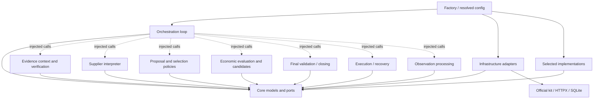

# B — Proposed V2 architecture

**Status:** architecture approved in principle; implementation contract frozen in C; source unimplemented. [Plan](../21-negotiation-v2-plan-2026-10-10.md) · [Assessment](A-current-architecture.md) · [Contracts](C-interfaces.md).

## 1. Scope and design decisions

Use a domain-specific modular Python application. Start with one coordinator, one active capacity case, one active supplier operation, and serial commercial scheduling. Use asynchronous I/O internally so model/transport waits can be bounded and supervised. “Serial” describes scheduling, not a requirement to reuse the blocking V1 loop. The existing V1 serial and async commands continue to exist until a deliberate migration.

V2 has a coherent new namespace. Do not rename the existing `negotiator/evidence.py` into a package or move all legacy modules. Do not introduce autonomous LLM agents, a workflow framework, a vector database, training, or a distributed broker for the first slice. The prebuilt local evidence index is sufficient until relevance experiments demonstrate otherwise.

| Decision | Alternatives considered | Recommendation and consequence |
|---|---|---|
| V2 placement | Expand PackageAgent; reorganize all root modules; sibling namespace | `negotiator.v2`; extra conditions in V1 preserve coupling, while moving everything delays the slice |
| Domain schemas | Dicts; dataclasses; strict Pydantic | Existing Pydantic supports boundary validation/JSON schema. Frozen tuples/typed fields prevent nested mutation; no provider-specific objects |
| Strategic state | More agent fields; JSONL only; SQL events/outbox | SQLite event log plus derived snapshots/outbox. One transaction commits state and operation; JSONL is an export, not a second authority |
| First intelligent policy | Interpreter + LLM proposer + LLM selector; fused adviser; interpreter + deterministic capacity policy | Third option isolates interpretation benefit and costs one model call. Hooks still support the other treatments |
| Price construction | Reuse inverse everywhere; new universal optimization; finite certified candidates | Finite price set first, with optional proven monotonic inverse later. Relationship cost need not be globally solved to test useful packages |
| Outgoing language | Model writer; free-form strategy text; templates | Templates plus canonical claims/question library. Model rationale stays internal |
| Runtime reuse | Call current `play_case` unchanged; repair all CaseRunner paths; small new coordinator around reusable HTTP | New coordinator for V2, plus optional V1Adapter. Use existing low-level patterns with explicit lifecycle corrections |
| Research extensibility | Arbitrary plugin loading/tool agents; one fixed selector; registry of proposal/selection bundles | Simple vetted Python registry and read-only evaluation capability, bounded by one decision budget |

## 2. Proposed package tree

These files are targets for later tasks; none is created as production code by this plan. Start with flat files where a subpackage would contain one small function; split only when useful. Avoid empty “future research” packages.

```text
src/negotiator/
├── agent.py, evaluator.py, evidence.py, ...     # V1 preserved
├── lab/                                      # Existing experiment platform
└── v2/
    ├── core/
    │   ├── models.py                         # Immutable domain values/unions
    │   ├── ports.py                          # Protocols; no concrete implementations
    │   ├── events.py                         # Versioned event payloads
    │   ├── errors.py                         # Typed faults and rejected outcomes
    │   └── serialization.py                  # Canonical JSON/hash rules
    ├── evidence/
    │   ├── resolver.py                       # Source priority/scope/basis/conflicts
    │   ├── prepare.py                        # Static indexes and manifests
    │   ├── context.py                        # Case/live context and relevance
    │   ├── documents.py                      # Parse records and known structures
    │   └── claims.py                         # Canonical build/verify/disclosure
    ├── intelligence/
    │   ├── interpreter.py                    # Structured model interpreter
    │   ├── fallback.py                       # Conservative observed-field fallback
    │   └── feedback.py                       # Outcome observations, no causal claims
    ├── strategy/
    │   ├── registry.py                       # Explicit IDs and compatible bundles
    │   ├── baseline.py                       # Pure deterministic fallback hooks
    │   ├── capacity.py                       # Grounded bounded exchange intents
    │   └── selection.py                      # Deterministic/optional model selector
    ├── economics/
    │   ├── candidates.py                     # Legal complete package construction
    │   ├── official.py                       # Official cost adapter
    │   ├── estimates.py                      # Evidence-derived scenarios
    │   ├── prices.py                         # Tick construction/certification
    │   └── closing.py                        # All-thread eligibility/comparison
    ├── execution/
    │   ├── render.py                         # Templates/verified claims/questions
    │   ├── validation.py                     # Shared final send/close boundary
    │   ├── executor.py                       # Durable dispatch and acknowledgement
    │   └── recovery.py                       # Reconcile exact operations, never guess
    ├── orchestration/
    │   ├── loop.py                           # Decision lifecycle/case coordinator
    │   ├── state.py                          # Pure state projection/reconstruction
    │   └── budgets.py                        # Clock/admission/call budgets
    ├── adapters/
    │   ├── official.py                       # Pinned official arithmetic oracle
    │   ├── claims.py                         # Resolved-facts canonical claim oracle
    │   ├── recorded.py                       # Offline fixture codec and replay DTOs
    │   ├── arena.py                          # Allowed gateway + transport
    │   ├── data.py                           # DataPackage/readers -> typed records
    │   ├── model.py                          # Provider protocol and bounded requests
    │   ├── sqlite.py                         # Store/events/outbox/snapshots
    │   ├── legacy.py                         # V1 decision and legacy journal adapter
    │   └── lab.py                            # Config/attempt/trace projection
    ├── config.py                             # Resolved immutable effective config
    └── factory.py                            # Composition root/dependency injection

tests/v2/                                     # Contracts, behaviors, failures, replay
tests/fixtures/v2/                            # Versioned cases/replies/labels/manifests
```

The conceptual experiment module lives in existing Lab plus `tests/v2` and a small evaluation tool; do not duplicate the Lab under `v2/experiments`. Research strategies become real modules under `strategy` only after an isolated experiment is approved.

## 3. Dependency graph

Arrows mean **may import/call**, not chronological data flow. All component packages may import `core`; the diagram abbreviates those repeated arrows. Concrete adapters implement core ports. `factory` is the only composition root that imports all selected implementations.



Forbidden dependencies: core -> provider/client/SQLite/strategy; evidence -> strategy or model provider; economics -> LLM/interpreter/runtime transport; strategy -> live Arena methods/state writes; interpreter -> price solver/send/closing; renderer -> model gateway; executor -> strategy/package changes; evaluation inputs -> public leaderboard/Cbest/backoffice. Implementations depend on ports rather than importing the factory or unrelated concrete modules. Validator may call injected economic and claim-verification ports; policies may call injected read-only candidate/evaluation services.

## 4. Decision lifecycle and information flow

```mermaid
sequenceDiagram
    participant R as Coordinator
    participant G as Arena gateway
    participant S as State/outbox store
    participant E as Evidence context
    participant I as Interpreter
    participant P as Strategy bundle
    participant C as Candidates/economics
    participant V as Renderer/validator
    participant X as Executor/recovery
    R->>S: Load state, verify config/source versions and pending operations
    opt Pending or uncertain operation
        R->>X: Reconcile exact ID/payload
        X->>G: Permitted state reads / same-ID retry when safe
        X->>S: Persist proven outcome or recovery-required state
    end
    R->>G: Refresh permitted authoritative state/messages
    R->>S: Deduplicate observations and project state
    R->>E: Build immutable context from prep + case + live input
    Note over R,C: Agreed/deadline/exhaustion may go straight to deterministic closing
    R->>I: Interpret grounded sources with total call budget
    I-->>R: Assessment or explicit fallback
    R->>P: Propose commercial intents from snapshot
    P-->>R: Intent batch with citations and uncertainty
    R->>C: Generate legal tick candidates; evaluate complete costs/scenarios
    C-->>R: Approved evaluated candidates plus rejections
    R->>P: Select candidate ID from approved batch
    P-->>R: Decision ID/rationale (no modified terms)
    R->>V: Render approved terms/claims/question; validate against fresh state
    V-->>R: Validated exact payload or typed rejection
    R->>S: Atomic CAS commit: strategic events + reservations + operation outbox
    R->>X: Dispatch owned operation, verify freshness after limiter wait
    X->>G: POST exact persisted payload and move ID
    G-->>X: Acknowledgement/reply or uncertainty
    X->>S: Persist operation outcome and new authoritative observations
    R->>S: Apply deterministic feedback; revise assessments next turn
```

Context preparation is not a model planning stage. Before session open, hash/index explicitly selected package and release files and known supplier/part records. After opening, apply case facts, live messages, current quote standards and document records. A new live event yields a new context version. Semantic retrieval and assessor choice can later vary, while the underlying evidence records remain available.

Initial scope: delivery and commitment exchanges, keep current package, bounded clarification question, and request deterministic closing evaluation. Never promise volume outside schema. Requests for cost breakdown/schedule and deterministic workbook extraction are follow-on capabilities, not mandatory model tools in the first loop. Adverse facts stay in the internal assessment even when outward claim policy chooses not to disclose them.

The model interpreter returns observations and separately labelled hypotheses. Code checks citation existence, supplier scope, exact message spans, enum values and schema; semantic correctness needs independent labels/tests. The initial capacity policy proposes intents only for supported dimensions, retains a baseline intent, and excludes known refused exchanges without new evidence. Candidate generation derives numeric prices/terms entirely in code and reports why an intent is infeasible. Candidate selection receives economic values and uncertainty as private decision inputs; an external model receives only the permitted projection in C.

Closing is a separate deterministic path. `agreed`, final offers, rounds exhaustion, explicit close requests, and deadline admission all use the same all-thread eligibility and economic comparison. Models can request that comparison; they cannot bind an accept or walk-away. The coordinator has sole closing ownership.

## 5. State, persistence and restart

Use a versioned event log with a materialized `NegotiationState`. Events are immutable; snapshots are derived and replaceable. Each event has a run/session identity, unique event ID, monotone local sequence, parent/correlation IDs, source timestamp when available, receipt timestamp, schema version and typed payload. Deduplicate official messages by session/thread/message ID; if missing, use a documented stable fingerprint and flag ambiguity. Arrival order does not prove commercial causality.

Keep three separate projections:

| Projection | Authority and content |
|---|---|
| Server | Session/thread status, standing sheets, accepted messages, counted rounds/deadline evidence, terminal proof; only gateway observations modify it |
| Strategic | Assessments, attempted intents, candidate/decision linkage, refusals, outstanding questions, evidence outcomes, final-offer observation evidence; no server truth override |
| Operational | Outbox ownership, exact payload/ID, validation basis, pending/uncertain requests, local run health; an operational failure is not a commercial walk-away |

SQLite commits events, a new head version, claim reservations, and an operation together. Use compare-and-swap against the input head version and source/config/context fingerprints. Never hold a transaction/lock over model inference, document parsing, limiter waits or HTTP. A stale proposal is discarded or recomputed. A late answer from a cancelled model call cannot mutate state.

Persist raw observations plus bounded validated model artifacts; do not persist private chain-of-thought. Alternative interpreters can derive their own assessment revisions from the same source history. Strategy-specific memory is schema-versioned and namespaced; the first slice needs only generic attempted/refused-exchange records. It is not an untyped mutable blob.

```mermaid
stateDiagram-v2
    [*] --> Prepared
    Prepared --> Ready: sources/config admitted; session opened or recovered
    Ready --> Deciding: immutable snapshot
    Deciding --> Ready: stale/invalid proposal; no dispatch
    Deciding --> OperationPrepared: atomic validated intent commit
    OperationPrepared --> Awaiting: dispatch exact payload
    OperationPrepared --> Ready: proven never dispatched; release reservation
    Awaiting --> Ready: acknowledged reply; observations/feedback committed
    Awaiting --> RecoveryRequired: outcome unknown / operational budget exhausted
    RecoveryRequired --> Ready: proven rejection or reconciled reply
    RecoveryRequired --> Awaiting: admitted same-ID replay
    Ready --> Closing: deterministic fresh close decision
    Closing --> Awaiting: owned close operation prepared and submitted
    Awaiting --> Ended: authoritative terminal proof
    RecoveryRequired --> Ended: server terminal proof reconciled
    Ended --> [*]
```



On restart: verify run/config ownership; load snapshot and replay later events; preserve pending operation and reservations; fetch permitted server state; reconcile before any new POST. Refusal history and sent/acknowledged attempts survive. Monotonic process times are never restored. Unknown rounds or uncertain remote outcome require recovery, not a fresh session or reset memory.

Legacy JSONL is read/imported without modification. Preserve unknown/abandoned legacy operations as historical ambiguous records unless there is proof of their disposition. Importing an old `result` does not create terminal proof. Existing Lab records keep original and recovered outcomes separately. New V2 storage does not retroactively “repair” old scores.

## 6. Validation, disclosure and economic authority

Incoming partial supplier sheets are preserved exactly as observed. Resolve closing defaults separately using official precedence: buyer defaults -> quote standards -> fixed case terms -> explicit sheet. Validate explicit fields before allowing them to override fixed/schema authority. Keep resolved commercial terms and transmitted negotiable terms as distinct typed values.

Supplier valuation uses a different reference: current quote standards override dossier/master defaults field by field. It must not accidentally use buyer closing defaults as the supplier reference. Both views are versioned and derived from the same evidence sources.

At every outgoing boundary, require: legal action kind; exact negotiable field set for offer sheets; allowed options or verified standards exception; positive finite two-decimal price; correct type/basis; must-haves; finite official complete cost; compatible claims/disclosure; recipient/session/standing-offer ownership; current state; admitted timing/rounds; no unresolved conflicting operation; and protocol payload limits. Final rendering happens before validation. Replayed operations cannot bypass state/economic validity checks, and their ID/payload cannot be mutated to repair a rejection.

Offer price numbers may be private-model-visible candidate values, but official economic calculations, reservation values, targets, lack of alternatives, urgency, and internal estimates are never passed wholesale to a writer or included in outgoing prose. Models see a purpose-specific projection. Document text may itself contain private values; field allowlisting alone is insufficient. Attachments and snippets require a reviewed disclosure classification. The first slice uses selected contextual snippets with provenance and no arbitrary original-file export.

Evidence classes distinguish canonical records, supplier statements, and internal estimates/hypotheses. A document can authoritatively establish that a supplier wrote a statement without making the statement true. Numeric supplier attachments are source-attributed observations unless independently verified. Missing/future/stale/incompatible facts remain explicit gaps. Relevance ranking must not remove all adverse evidence from internal decision context.

Economic evaluations keep nominal official cost, full components, estimate version and sensitivity scenarios. Scenarios are not confidence intervals unless supported by a calibrated model. Missing executable alternative is a tagged value, not serialized infinity and not no-deal score. Operational fallback cost is separately evaluated. Initial no-alternative final policy closes on an eligible acceptable standing deal or continues only through an explicit bounded policy; it performs no undefined expected-loss arithmetic.

## 7. Budgets and reliability

One `DecisionBudget` applies across preparation of live inputs, interpretation, candidate work, selection, rendering, validation and limiter queue. Start from conservative clock evidence, charge elapsed time since observation, and reserve time for fallback and transport submission. Proposed initial local targets: buyer computation at most 35 s when the authoritative remaining window permits; interpreter at most 8 s; optional selector at most 4 s; at most two model requests per turn, with no automatic model retries. These are engineering targets to validate, not Arena guarantees.

HTTP phase timeout is separate from total operational deadline. Supplier generation may pause its buyer clock but does not create a fresh wave cap. If clock evidence is insufficient, disable expensive advice and use a conservative admitted action or recovery-required outcome. Do not let a cached reply start a new 60-second window. Store clock provenance and receive/request timestamps.

Transport timeout, cancellation and many retryable errors do not prove a POST failed. Bound reconciliation work, persist `uncertain`, return a resumable operational result, and retain ownership. A definite 422 can fail an operation; 409/5xx/quota errors require classification and server evidence, not a universal “failed” label. On final-state confirmation, distinguish whether a pending operation is proven applied, invalidated, or unresolved at terminal observation.

For initial use, one execution owner holds a team-key lease for the supported runtime and no other launcher uses that key concurrently. Normal CLI, adapted V1 and Lab must acquire the same admission lease on the chosen host. A multi-host deployment needs a shared authority; a local lock cannot protect independent laptops. This is an operational restriction, not a claim that a global broker is implemented.

Async RFQ admission later requires supervised task completion/errors, all-thread snapshots, no awaited state lock, bounded unresolved/watchdog exit, shared limiter/capacity, queued-case wave checks, and restart/transport tests. Do not enable async by merely relaxing the current adviser feature check.

## 8. Effective configuration and deployment

Resolve once before opening: schema/agent version, strategy proposal/selector bundle, interpreter implementation, template/claim versions, data/prep/case hashes, economics/estimate and closing policy, runtime mode, budgets/fallback, model protocol/identity/effort/sampling/timeout, allowed capabilities, endpoint identity, and recovery rules. Credentials are injected references and never serialized/hash inputs; operationally meaningful provider identity is recorded without keys.

Use explicit config file/arguments over documented environment mappings over checked-in defaults, reject unknown/incompatible options, and record origin and effective value. Legacy guidance is frozen into V1 config at resolution, not read differently by each factory. V2 ignores ambient legacy feature flags unless a named migration maps them. Model nondeterminism means equivalent config does not imply identical model decisions; deterministic parts must remain equivalent.

CLI and Lab use one factory. Add a versioned checkpoint envelope preserving the legacy schema and supporting agent implementation + resolved configuration + prep/source fingerprints. Reject V2 in an old worker before session open. Do not reinterpret old checkpoint hashes. V1 and V2 record distinct agent identities and trace versions; old viewers continue to open historical records.

Buyer orchestration continues to run where the command executes. The existing Lab server stores and displays records; it does not become a negotiation/model service by this plan. No new cloud deployment is needed for offline or single-owner local capacity testing. Later deployment selects a reviewed host and rehearses data, inference protocol, deadlines, lease, recovery and exact served revision separately from dashboard health.

## 9. Trace and explainability

Every turn links raw evidence/context version -> assessment revision -> intent IDs -> candidate IDs and rejection reasons -> nominal/scenario cost evaluations -> selected candidate -> close decision if requested -> final rendered payload -> validation -> operation ID and payload hash -> acknowledged/uncertain outcome -> response -> feedback/state revision.

Diagnostic traces preserve candidate versus selected versus validated versus submitted versus acknowledged distinctions. Only the operation payload is the authoritative sent record. A concise rationale with citations explains a proposal; it is not proof of correctness. Rejections and fallback paths receive the same linkage. Session and attempt IDs prevent one hosted dump from being reused across unrelated repeats.

Export JSONL and a Lab projection from the durable store. Keep private assessment/economic details in appropriately controlled inspection artifacts; public/shared exports apply a separate redaction policy. A failed export must not alter execution state. M6 adds an inspectable turn view to existing Lab, without rebuilding it.

## 9. Implementation refinements after architecture approval

The architecture is approved in principle. The initial scope and authority remain the same; C §8 now resolves the implementation choices. [Task specs](task-specs.md) and the executable suite are its implementation handoff. Add `adapters/official.py`, `adapters/claims.py`, and `adapters/recorded.py` to the module tree. Official/legacy imports live in adapters and are injected through core ports. This corrects the ambiguous idea that economics could directly import arena_kit while remaining independent of concrete infrastructure.

The module graph enforced by tests is: each feature package imports core and its own package; adapters import core/adapters plus existing libraries; config imports core/config; only factory imports selected concrete features. Root v2/__init__.py stays empty. No dynamic strategy import, eval/exec, network/process API outside adapters, or production import from tests. Inject collaborators to cross package boundaries. These checks are static import guards, supplemented by narrow capability injection; they do not pretend to prove absence of every possible side effect.

M1 must already connect recorded case → evidence context → typed mock assessment → proposed intent → generated candidate → official-cost/mock-certified evaluation → selection → rendering → validation → scripted execution → persisted feedback/result. Include immutable effective config, input versions, artifact hashes and DecisionRecord storage. Fake provider/server responses stay marked as fixtures. The first offline package/cost is a demo golden; no production supplier intelligence or recovery claim follows from it. M2–M5 replace mock ports incrementally under the same contracts. Basic integration and replay are not deferred to M5/M6.

Supplier assessment has four collections: observations, reported constraints, preference hypotheses and uncertainties. An observation records speech; a reported constraint is still an unverified supplier report; hypotheses may have opposing support; approval/conditional/contradictory gaps stay explicit. Assessment revisions are appended with parent references and their decision records preserve the version used. No interpreter mutates legal options, numeric costs or state.

DecisionRecord is a versioned immutable graph of all ten stages, including exact selected/evaluated identity, final validation/payload hash, owned operation, acknowledged/unknown execution and feedback. The SQLite record/artifact store starts in M1; operation/state/claim atomic commits extend it in M5. Generic structured assertions and typed term fields allow later strategy bundles/routers to consume these records without changing evidence, economics or execution. Future behavior models receive read-only historical assessment/feedback views; no learning machinery is part of this delivery.

Runtime defaults are one case owner and one outstanding operation. Rejected closes while authoritative status is open remain recovery_required. Unknown requests retain exact identity/bytes/reservations. Retry exhaustion does not abandon ownership. All closing triggers use the fresh shared close evaluator and final validator. Absolute deadlines and event-derived round evidence are explicit inputs. Serial first; async, shared cloud broker and multi-agent frameworks remain outside this implementation cutline.
