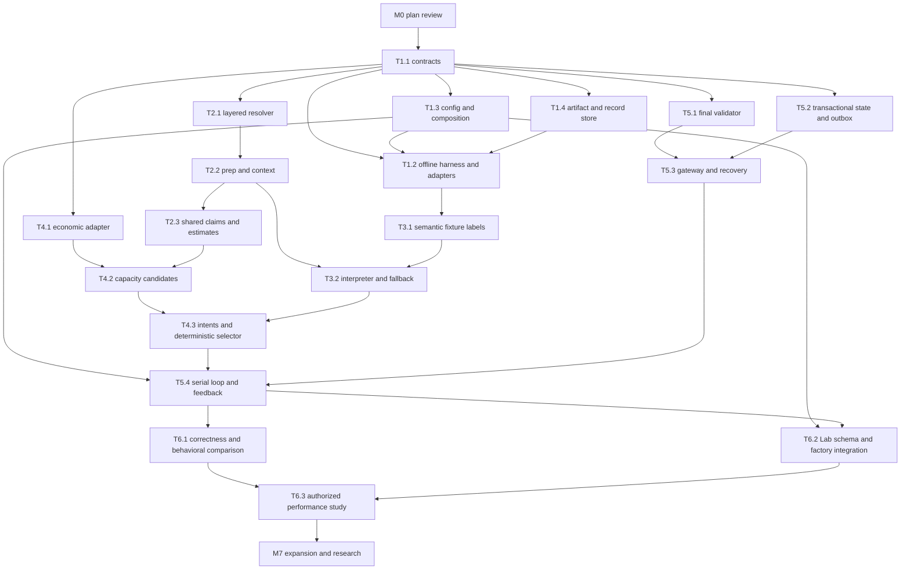

# D — Migration and implementation roadmap

**Status:** proposed work; no task below is implemented by this planning deliverable. [Tracker](../21-negotiation-v2-plan-2026-10-10.md) · [Contracts](C-interfaces.md) · [Evaluation](E-evaluation.md).

## 1. Delivery order and cutline

The first milestone is a **complete typed offline skeletal loop with recorded results**; the first product is the locally verified multi-turn capacity loop in M5. Freeze shared models first; develop evidence, economic validation, fixtures, and state/execution in independent tasks. Add a real provider only after fake-model contracts work and a separate inference allowance exists. Hosted comparison is a later funded gate.

These arrows describe integration dependencies. Fixture labelling can start immediately from current P10; validator can be built with a fake evaluator; interpreter can use a prepared fixture while evidence is implemented; state/gateway can use dummy valid actions. No task should edit another owner's module to hide a contract mismatch. Propose a contract revision instead.

Initial release capabilities: one capacity supplier, complete offers, approved commitment/delivery variants, grounded interpretations, questions from a bounded library, canonical claims when eligible, deterministic closing, persistent feedback and resumable operations. Multi-supplier RFQ scheduling, generic free-form writer, universal inverse pricing, all document categories, broad basket estimates, research lookahead and global cloud brokerage are outside this cutline.

## 2. Milestones and task handoffs

Every task row starts `planned`; assign owner and evidence as work begins. Use one reviewable PR/task per row unless a small closely coupled pair is deliberately combined. Test descriptions refer to observable outcomes, not implementation-mirroring assertions. Run targeted tests during development and required locked suite/Ruff checks before push; distinguish pre-existing baseline failures and contract changes instead of weakening tests.

### M0 — Assessment and architecture agreement

**Objective:** establish source-grounded reuse decisions and interfaces. **Prerequisites:** existing repository/audit/attached requirements. **Existing affected code:** none; docs only. **New modules:** none. **Interface changes:** proposed `negotiator-v2/1`.

**Tasks:** review A–F, select decisions ADR-01–09, assign owners, choose frozen V1 baseline, identify unsupported runtime assumptions. **Verification:** source/symbol/link consistency; offline focused checks in A. **Acceptance:** review package clearly separates implemented/reusable/defective/proposed behavior and defines the first capacity scope. **Risk:** mistaking specification for implementation or a branch review for current main. **Deliverable:** approved contract/design revision and decision log. **Current status:** architecture approved in principle; executable preparation verified locally, production implementation planned. Baseline selected in A §7.

### M1 — Complete offline skeletal loop, records and reproducibility

**Objective:** recorded case → Context → Mock assessment → Strategy → Candidates → Economics → Selection → Validation → Recorded result, including rendering, scripted execution and feedback links. Use the actual typed C ports. **Prerequisite:** architecture approved in principle and frozen interface handoff. **Existing production affected:** none; no CLI/default/V1 changes. **New modules:** core, config/factory, recorded codec, injected orchestration skeleton, basic SQLite artifact/record store. No real Arena/model transports.

| Task | Small assignments / required result | Status |
|---|---|---|
| T1.1 | a immutable values/terms/serialization; b assessment/ports; c DecisionRecord/config; d remaining DTO batches | a–c verified locally; d planned |
| T1.2 | a typed fixture bindings/recorded codec; b full injected offline pipeline, not a one-step proposal stub | Planned |
| T1.3 | Immutable effective config and explicit fake clock/model/server/store composition from the start | Planned |
| T1.4 | Versioned fixtures, exact raw bytes, immutable artifacts and append-only SQLite DecisionRecords; restart reload/replay hashes | Planned |

[Exact files, imports, instructions, dependencies, test selectors and exclusions](task-specs.md) govern each subtask. First three assignments are T1.1a, T1.1b, T1.1c; codec and loop follow once DTOs exist. M1 storage is the same adapter extended by M5 atomic state/outbox work. Advanced components are typed recorded/mock ports; their algorithms are not smuggled into the codec.

**Required gates:** core value/port/config/record invariants, actual typed complete offline loop, unchanged frozen replay hashes, recorded model-output variability, saved record reload without send. Active opaque fake routing is scaffolding evidence only. The demo package is 28.34/42/23400/24 at €1,335,154.08 with estimates explicitly disabled; its fake acknowledgement is not a deal. V1 baseline remains 35 days under its frozen identity.

**Acceptance:** all ten stage artifacts are connected and persisted under schema/config/input hashes; relevant task tests pass with required module prefixes; no external calls or hidden golden answers. Missing later modules are separately expected failures and do not count as implemented. **Deliverable:** full offline typed skeleton, reference port fixtures, effective config and reproducible structured record. **Excluded:** live/recovery readiness, real semantic intelligence, portfolios and default promotion.

#### T1.1a completion evidence — 10 October 2026

**Task / source revision:** T1.1a, implemented from `4c905b10be1f576de9b68be9c120cf6796ae4561` on the existing remediation branch. A separate implementation branch could not be created because `.git` is read-only in this workspace; all pre-existing working changes were planning documents, fixtures and V2 tests and remain preserved.

**Owned files:** `src/negotiator/v2/__init__.py` (empty), `core/__init__.py`, `core/models.py`, `core/errors.py`, and `core/serialization.py`. Added strict frozen value models, field-aware terms, immutable tuple boundaries, canonical decimal JSON strings, `ContractViolation`, and sorted UTF-8 canonical JSON/SHA-256 helpers. No V1 source, dependency, fixture, or assertion changes; no hosted/model calls.

**Verification:** required-prefix foundation selector: **22 passed, 1 expected UNIMPLEMENTED xfail, 56 deselected**. Boundary contracts: **19 passed**. Ruff over `tests/v2 src/negotiator/v2`: **all checks passed**. Additional direct JSON round trips for effective dates and nested index clauses passed.

**Acceptance:** T1.1a owned gates met. Remaining M1 work includes T1.1b–d (assessment/ports now complete; records/config and remaining DTOs still planned), T1.2 typed fixture codec and full offline loop, T1.3 composition/config integration, and T1.4 persistence/replay. M1 and V2 are not complete.

#### T1.1b completion evidence — 10 October 2026

**Task / source revision:** T1.1b, based on V2 commit `86eaea6` (T1.1a), itself based on development revision `4c905b10be1f576de9b68be9c120cf6796ae4561`.

**Owned files:** extended `src/negotiator/v2/core/models.py`; created `src/negotiator/v2/core/ports.py`. Added the eight grounded assessment schemas with separate observation, supplier-reported constraint, hypothesis, and uncertainty collections; citation shape and active-assertion grounding; explicit supplier authority; revision/parent fields; and typed Unicode quote spans. Added all C Protocols, including injected arithmetic/claim oracles and Clock, with the frozen method names, argument order, types, and sync/async forms. No interpreter/provider calls, strategy, economic logic, V1 changes, dependency changes, fixture/golden changes, or hosted/model calls.

**Verification:** exact port signatures: **21 passed**. AssessmentDraft guardrails: **5 passed**. T1.1a foundation selector: **23 passed**. Boundaries: **19 passed**. Ruff over `tests/v2 src/negotiator/v2`: **all checks passed**. Full V2 contract suite: **113 passed, 95 expected UNIMPLEMENTED xfails, 5 failures**. The five failures are the `DecisionRecord` round-trip and four invariant checks (including unknown-version handling), all deferred to T1.1c because `DecisionRecord` is not implemented; no T1.1a or T1.1b test regressed. The xfails are absent later components.

**Acceptance:** T1.1b owned tests and boundaries pass. At that task boundary, full contract collection had five T1.1c `DecisionRecord` failures; those are resolved in the T1.1c evidence below. Remaining M1 scope is T1.1d, T1.2 typed fixture codec and complete offline loop, T1.3 composition/config integration, and T1.4 persistence/replay. M1 and V2 are not complete.

#### T1.1c completion evidence — 10 October 2026

**Task / source revision:** T1.1c, based on V2 commit `1654a32` (T1.1b), following T1.1a commit `86eaea6` and development revision `4c905b10be1f576de9b68be9c120cf6796ae4561`.

**Owned files:** extended `src/negotiator/v2/core/models.py` and `core/serialization.py`; created `src/negotiator/v2/config.py`. Added literal-version `DecisionStage`, `DecisionRecord`, and `EffectiveConfig` models, canonical config/record hashing, revision/parent and SHA-256 reference validation, ten-stage ordering, completed/failed/skipped artifact/reason requirements, downstream-stage dependencies, selection-to-evaluation and execution-to-validation/operation integrity, and explicit registered strategy/config validation. Config resolution consumes only the supplied mapping and does not read ambient environment values. No persistence, orchestration, provider, strategy, economics, V1, test, or fixture changes.

**Test collection:** the previous **241** count covered all of `tests/v2`; the **213** count covered only `tests/v2/contracts`. Current collection confirms **241 total**, comprising **213 contract** tests and **28 acceptance/integration** tests. No tests were excluded or changed.

**Verification:** T1.1c record/config selectors: **7 passed**. Foundation suite: **79 passed**. Boundary suite: **19 passed**. Ruff over `tests/v2 src/negotiator/v2`: **all checks passed**. Complete V2 contract suite: **120 passed, 93 expected UNIMPLEMENTED xfails, 0 failures**. The five `DecisionRecord` failures from T1.1b are resolved. Foundation tests cover T1.1a/b with no regressions. Remaining xfails are absent components assigned to later tasks; no owned task test is xfailed.

**Acceptance:** T1.1c owned tests pass and the complete contract suite has no unexpected failures. Remaining M1 scope is T1.1d, T1.2 typed fixture codec and complete offline loop, T1.3 composition/config integration, and T1.4 persistence/replay. M1 and V2 are not complete.

### M2 — Unified evidence and actual runtime preparation input

**Objective:** claims and economics resolve the same scoped/versioned facts, and the harness consumes prepared data. **Prerequisite:** T1.1; integrates T1.2/T1.3. **Existing code:** `DataPackage`, `context`, `dossiers._cost_row/supplier_estimate`, `claims`, official readers. **New modules:** evidence resolver/prepare/context/documents/claims, data adapter. **Interface change:** PreparedEvidence/EvidenceContext and typed source/estimate projections replace independent dictionaries/SQL fallback.

| Task | Concrete implementation | Verification / acceptance | Status |
|---|---|---|---|
| T2.1 | Normalize source families needed for capacity from base/release/case; preserve collisions, replace existing IDs by explicit priority, validate supplier/part/date/price basis | Synthetic `cost:310010` case override reaches estimator and verifier identically; same-priority conflict never chooses arbitrary row; release rows work without SQL mutation | Planned |
| T2.2 | Build versioned prep artifact with source/parser/schema hashes and scope indexes; load it through harness before session opening | Warm/cold contexts equivalent; changed sources rejected or rebuilt before clocks; no recursive hashing per turn; document parse gaps visible | Planned |
| T2.3 | Adapt canonical claims and estimate calculations to shared resolved records; preserve supplier-wide scope/adverse facts; field-level current quote-standard reference | Same IDs/units/override values in claims and estimates; P10 supplier estimate nominal/low/high and explicit assumptions; unsupported bases disable dependent values | Planned |
| T2.4 | Add dynamic case/live message/doc layering and multi-part relevance scope without basket economics claims | New case letter replaces prior ID; current messages invalidate context; P07/P15 parts retained; no first-part-only assertion represents basket | Planned |

**Tests:** base/release/case precedence, partial replacement/missing fields, incorrect explicit release, stale/future facts, scorecard scope, statement-vs-truth, unit 1/100/1000 joins, cache invalidation, warm-path consumption. **Acceptance:** the running offline decision pipeline actually receives a loaded prep-backed context; claims and economic scenarios agree on source revisions and compatible basis. **Risk:** official data reader does not overlay SQL, and conflicting facts may need human resolution. **Deliverable:** prepared artifact format, strict resolver and context provenance example for P10.

### M3 — Grounded supplier interpretation

**Objective:** establish a testable semantic assessment independent of strategy. **Prerequisites:** T1.1/T1.2; prepared fixture/context from M2 for integration. **Existing code:** adviser schema/quote patterns, traits/source refs, recorded P10 supplier replies. **New modules:** interpreter/fallback/model adapter, semantic fixtures/labels. **Interface change:** SupplierInterpreter -> versioned attributed assessment, not an approved package.

| Task | Concrete implementation | Verification / acceptance | Status |
|---|---|---|---|
| T3.1 | Label original and controlled A–F supplier replies; observed request/refusal/condition/role versus inferred preference/unknown; record expected admissible actions | Labels reviewed without looking at candidate result; actual P10 schema fixed; edited replies labelled synthetic | Planned |
| T3.2 | Implement bounded structured interpreter and deterministic fallback through fake ModelGateway first | Exact spans/IDs/schema valid; no ungrounded numerical willingness; contradictions retained; timeout/invalid/refusal paths visibly fallback within budget | Planned |
| T3.3 | Implement purpose-specific provider protocol adapter, cancellation/capacity control and call trace; endpoint-shape preflight using fake transports | Delayed result cannot update state; total timeout includes queue; secrets/private economics absent; protocol tested independently from old inference probe | Planned |
| T3.4 | If explicitly funded, run fixed labelled interpreter batch on selected endpoint; preserve prompt/model/output/usage fingerprints | Measure precision/recall, unsupported claims and latency; no hosted negotiation required; budget separate from Arena allowance | Planned; authorization-dependent |

**Acceptance:** A–F assessments are grounded, distinguish observations/hypotheses, preserve meaningful role/conditional/contradictory information, and degrade explicitly. M3 can be locally verified with fake/replayed model outputs; real-model semantic quality must not be claimed until T3.4. **Risk:** quote validation permits misinterpretation; model confidence is not calibrated. **Deliverable:** typed interpreter and labelled assessment report, with live-provider status explicit.

### M4 — Capacity strategy intents and certified economic candidates

**Objective:** transform differing supplier evidence into different defensible legal choices. **Prerequisites:** T1.1; economic adapter can begin independently; integrates M2/M3. **Existing code:** official arithmetic, optimizer enumeration, closing evaluator, adviser variant ideas; no new conditions inside PackageAgent. **New modules:** economic adapter/estimates/prices/candidates/closing, strategy baseline/capacity/selection/registry. **Interface changes:** generation/evaluation batches, intent/selection ports, read-only CandidateResearch.

| Task | Concrete implementation | Verification / acceptance | Status |
|---|---|---|---|
| T4.1 | Wrap full official cost/components and complete terms; quote/estimate reference rules; independent package and close evaluation | Kit parity; no zero/nonfinite prices; wrong supplier/standing ID cannot qualify; no alternative has tagged semantics; estimate scenarios reported | Planned |
| T4.2 | Implement legal non-price enumeration and finite positive tick candidate sets; reject infeasible intent/basis/ceiling; bound candidate work | P10 only 23,400 volume, allowed 35/42/56 lead and 12/24/36 commitment; payment fixed; relationship nonmonotonic candidates certified after rounding | Planned |
| T4.3 | Add deterministic baseline and grounded capacity intent policy/selector; use assessments, refusals and contradictions; register bundle | A delivery statement changes eligible/ranked exchange; commitment request changes intent; refusal suppresses unsupported repetition; no legal exchange yields question/close, not invented terms | Planned |
| T4.4 | Add independently selectable LLM ranking treatment and bounded read-only evaluation façade | Model selects approved batch ID only; invalid output uses deterministic fallback; dummy lookahead bundle runs without modifying evaluator/evidence/runtime | Planned; optional for first slice |
| T4.5 | Implement robust equal-cost/ceiling inverse as optional later capability if needed | Known valid reference preserved, two roots/preferred branch, unreachable/minimum, precision/tick certification, bounded uncertain search; never reuse old helper unguarded | Deferred unless required by measured candidate gap |

**Tests:** independent economics tests plus metamorphic A–D tests; adverse evidence affects assessment and appropriate question, not necessarily every price. Test no-legal-package and both-sided relationship-cost curves. **Acceptance:** fake or valid grounded assessment changes candidate decision for a documented commercial reason; every output is legal and has complete costs/assumptions; swap strategy bundles under the same service contracts. **Risk:** buyer-cheap package may be unacceptable to supplier; finite candidates aren't optimal; horizon-capped costs don't measure all real contractual exposure. **Deliverable:** capacity decision pipeline and candidate/selection trace.

### M5 — Shared validation, durable serial loop and feedback

**Objective:** complete a multi-turn capacity session locally, retain state across restart, and return truthful operational outcomes. **Prerequisites:** T1.1 for independent runtime work; M1–M4 for integration. **Existing code:** transport/readers/journal/claim-key patterns; current runners retained for V1 legacy path, not copied wholesale. **New modules:** renderer/validator/executor/recovery, SQLite store, state projector/budgets/coordinator, feedback processor, Arena gateway. **Interface change:** typed validated artifacts/commit/dispatch permit/execution results/event history.

| Task | Concrete implementation | Verification / acceptance | Status |
|---|---|---|---|
| T5.1 | Implement renderer and one independent final validator for offers/questions/accept/walk; inject economics/claim checks | Final payload exactly validated; correct API limits; complete negotiable fields; illegal/partial/mixed actions and private assertions blocked; recipient/standing/current cost validated | Planned |
| T5.2 | Implement SQLite events/snapshots/outbox, pure projection, artifact storage, atomic claims/intent commit and source-key dedupe | Crash before/after commit and restart reproduce same state; refused exchange/question/claim scopes survive; legacy logs import without fabricated terminal certainty | Planned |
| T5.3 | Add allowed gateway, exact persisted POSTs, conservative clock/round accounting, lease admission and bounded reconciliation | Repeated lost reply preserves same ID/bytes; no conflicting new operation; uncertain open doesn't reopen; rejected close while server open returns resumable failure; no spectator access | Planned |
| T5.4 | Integrate serial coordinator lifecycle and deterministic feedback; supervise all local tasks; evaluate closing globally | Local multi-turn P10 completes autonomously; `agreed`/deadline/exhaustion use identical checks; model/evaluator/parser/transport faults return bounded valid fallback or recovery-required | Planned |
| T5.5 | Run V1Adapter on new shared validated path and add legacy migration tests | Same validator applies to adapted V1/V2; historical V1 unchanged; changes in adapted V1 outcomes are explicit, not relabelled baseline wins | Planned |

**Tests:** E's failure/transaction matrix with barriers/fake clocks, state reconstruction and payload identity, economics/claim validation on all dispatch paths, parser exception, delayed model reply, unresolved operation, stale close, terminal without score enrichment. **Acceptance:** complete local A–F multi-turn scenarios with a fake model/server; no invalid action; refusal survives crash; ambiguity stays owned and run exits bounded; runtime consumes prep/context and final trace reflects actual outgoing bytes. Live-provider end-to-end status is separate if no call allowance exists. **Risk:** Arena does not expose enough operation evidence; safe result can be recovery-required rather than a deal. **Deliverable:** first V2 capacity vertical slice with deterministic fallback and V1 common-runtime adapter.

### M6 — Evaluation, launch parity and measured release decision

**Objective:** independently verify behavior, then measure performance under a single frozen config if funded. **Prerequisite:** M5 local slice; Lab config task may begin from M1. **Existing code:** Lab factories/workers/checkpoints/models/campaign/policy/evidence reports/UI, normal CLI. **New modules:** Lab adapter, trace projection and local evaluation manifest/tool. **Interface changes:** versioned agent/config checkpoint envelope and V2 trace projection; preserve legacy schema support.

| Task | Concrete implementation | Verification / acceptance | Status |
|---|---|---|---|
| T6.1 | Complete local semantic/decision/fault/regression suite; compare frozen V1, adapted V1, V2 baseline and adaptive capacity modes | Correctness and behavior measured separately; same cases/inputs; abstentions/fallbacks retained; cold/warm/restart parity; held-out labels excluded from tuning | Planned |
| T6.2 | Extend checkpoint envelope/factory/worker with explicit agent + resolved config + prep/data hashes; route normal CLI and Lab through same new factory; add final-action trace view | First deterministic move/feature activation equivalent across supported paths; unsupported old worker fails before opening; current UI/old reports preserved; final payload and ack visible | Planned |
| T6.3 | Pre-register and run specifically authorized hosted capacity/performance contract study after local gates | Exact baseline/config/data/provider, all planned original sessions/repeats, no mixed-history mean, recorded spend/failures/independence/latency; uncertainty stated | Planned; no allowance supplied |
| T6.4 | Apply scoped promotion criteria and write finding/completion/rollback evidence; leave default unchanged if inconclusive | No rollout based on one P10 observation, synthetic replay or cached repeat; full original results and known timeout/invalid-action metrics | Planned |

**Acceptance:** local tests establish justified adaptation and architectural boundaries; Lab preserves complete comparable records. Hosted improvement/default promotion requires funded original outcome evidence, not M5 completion. **Risk:** only one real capacity case, cached/stochastic suppliers, current D01/D02 campaign suite not representative, pre-existing suite failures. **Deliverable:** local evaluation report plus, when funded, frozen experiment report and retain/revise/promote decision.

### M7 — Expansion and research integration

**Objective:** add strategies/categories without reworking evidence/economics/validation/runtime contracts. **Prerequisite:** stable M5 interfaces and M6 gates for each promoted treatment. **Existing code:** per-category evidence and Lab test families; async runner patterns only after reliability review. **New modules:** capabilities with demonstrated use (research strategy, document parser, multi-part estimate, concurrent scheduler). **Interface changes:** additive versioned domain capabilities; any breaking change gets migration.

| Task | Scope and gate | Status |
|---|---|---|
| T7.1 | Expand price-increase/quality/raw-material evidence and strategies individually; supplier role/document/feedback contract tests and case-specific comparisons | Deferred |
| T7.2 | Add bounded question/document information-value policy and trusted workbook parsers; ensure scarce-round value and source fidelity | Deferred |
| T7.3 | Add async multi-supplier coordinator scheduling; fix/supervise worker/watchdog completion, immutable snapshots/CAS, unresolved exit, limiter/deadline/shared-key load and final-wave admission | Deferred; async blocked until these gates |
| T7.4 | Execute prioritized F research treatments one at a time; same candidate/economic/validation/outcome recording interfaces | Deferred |
| T7.5 | Add full basket/account and robust supplier estimate capabilities only with verified quantity/price-basis contracts | Deferred |

**Acceptance:** add and compare a new strategy without changes to evidence, economic evaluator, final validator or gateway; verify async/other categories separately. **Risk:** broad coverage distracts from measuring one working loop. **Deliverable:** isolated tested capabilities and per-treatment experiment decisions. M7 is not required for the first capacity milestone.

## 3. Minimum safe execution gate

Before any V2 Arena session is opened, require:

| Gate | Required evidence | Responsible tasks |
|---|---|---|
| Data/config | Explicit base/release/prep integrity; complete case capability/basis; no hidden fallback; config frozen | T1.3, T2.1–3 |
| Economic | Legal ticks, complete official costs, standards precedence, relationship scenarios or explicit approved degraded estimate mode | T4.1–2 |
| Final validator | Every outgoing action/close/replay admission follows independent guard; malformed/illegal/private payload cannot be sent | T5.1 |
| Persistent ownership | Atomic intent before request; one exact ID/bytes; unknown outcome and claim reservations preserved | T5.2–3 |
| Truthful terminal/restart | Only server proof ends case; bounded unresolved return; strategic/refusal state recovered | T5.2–4 |
| Time/round/key | Conservative admitted clock and rounds; fallback reserve; exclusive key owner/lease; no fictitious window refresh | T5.3–4 |
| Model | Protocol/output/budget fallback tested; approved data projection and inference allowance if used | T3.2–4 |
| Experimental accounting | Frozen checkpoint/config/manifest and per-attempt trace; session allowance explicitly supplied | T6.2–3 |

The gate is satisfiable without repairing dormant writer/belief scaffolds or V1's old async internals. If running V1 on legacy paths, their risks remain visible and their baseline outcomes aren't “fixed” by this gate. Do not silently enable a risky fallback path when the new runtime fails.

## 4. Migration plan

1. **Preserve:** name/freeze V1 checkpoint/config; retain original agent commands and records. Do not merge the current remediation branch merely because the V2 plan exists.
2. **Introduce:** new namespace, offline harness and explicit new agent selection in the common factory. Until enabled, existing commands retain behavior.
3. **Share verified boundaries:** V1Adapter and V2 use new validation/economic/execution contracts; any resulting change creates `v1-adapted` identity. Keep `v1-legacy` for historical comparison.
4. **Migrate effective config:** legacy basic checkpoint schema remains accepted; new envelope names agent, strategy, protocol, assumptions, prep and data hashes. Old workers reject new schemas. Installed-package tests ensure guidance and capability registry resources exist independently of cwd.
5. **Migrate durable state:** new runs use SQLite; legacy runs stay readable. Import raw logs and unresolved intent/result provenance, then reconcile owned sessions. Do not auto-resume a foreign session or manufacture outcomes from old journal `result` entries.
6. **Integrate Lab:** preserve old attempt/results, add typed trace attachment and metrics; no destructive database migration without backup/rollback check. Same factory resolves all supported new paths.
7. **Promote selectively:** keep default V1 until M6 decision; enable V2 for proven capacity scope with explicit config. Unsupported categories fail preflight or use a named V1 route, never silently switch mid-session. Rollback source/config is separate from pending-session recovery; do not restore V1 into a V2 session with uncertain operations.

## 5. Practical implementation discipline

Each task owns its files/ports/tests and has a small executable fixture. Implementation can be delegated after contracts are reviewed; this plan did not use or require autonomous negotiation agents. Merge core contracts first, then independently develop evidence/economics/runtime with fakes. Integrate one capacity loop before expanding.

No calendar commitment is made. Count delivered verified tasks rather than assuming a one-day rewrite before the competition freeze. If time is limited, deliver M1–M4 offline intelligent decisions with clear non-runtime status; do not label an unsafe loop operational. Record dependencies and consciously deferred scope in the tracker instead of expanding V1's conditional tree.

## 6. Executable handoff and updates

The architecture has approval in principle. [Task specifications](task-specs.md), [test catalog](test-catalog.md), [coding guide](implementation-guide.md), [review checklist](compliance-checklist.md) and [first three prompts](first-three-prompts.md) are normative handoff details. They refine these parent task IDs rather than opening another architecture. All production tasks remain planned.

After core contracts/codec merge, evidence, economics, interpreter-with-fake, validator-with-fake-ports, and store/projector work can proceed independently. Integration owner runs the milestone suite; acceptance owner runs metamorphic/recovery tests. Add the catalog's explicitly pending test bindings before implementing their feature. No missing component, passing mock or inherited V1 failure can be silently relabelled as implementation completion.

#### T1.1a–c foundation hardening evidence — 10 October 2026

**Scope / base:** separate hardening of existing V2 branch at `7e861cd`; T1.1d remains
planned. No V1 implementation, Protocol signatures, dependencies, golden payloads or golden
hashes changed. The generated test manifest was refreshed with the additional regressions.

**Contract decisions:** C §“T1.1a–c foundation hardening decisions” records Decimal semantic
identity/provenance, derived and verified package fingerprints, strict structured fields,
raw supplier ambiguity versus valid supplier-reported structured assertions, and parsed
versus registry/hash-verified executable configuration. These are clarifications of version 1;
no versioned golden correction was needed. Future composition must use require_verified_config;
this task does not introduce a runtime factory or claim runtime integration exists.

**Regression-first evidence:** before implementation, the initial 27 cases produced **19 failed,
8 passed**, reproducing all five gaps. Expanded coverage adds valid/invalid/round-trip terms,
raw ambiguity, configuration reconstruction/copies/hash/registry enforcement, nested index
clauses and Decimal context independence. Final hardening regressions: **40 passed**.

**Verification:** complete V2 contract, acceptance and integration suites, with core/config
required: **161 passed, 120 expected UNIMPLEMENTED xfails**, zero failures. T1.1a–c foundation,
guardrails, boundary and hardening selector: **160 passed, 2 expected xfails**. Every expected
failure is an absent deferred component: validation (33), interpreter (25), factory (19),
evidence context (12), official economics (8), preparation (6), selection (6), recorded adapter
(3), SQLite adapter (3), candidate generation (2), state (2), claims (1). Implemented components
cannot be hidden by these xfails. V2 source/tests Ruff and git diff whitespace checks pass.

**Environment / broader baseline limits:** uv is unavailable on PATH or the usual local install
path; checks used the existing Python 3.12 .venv directly without dependency changes.
Repository-wide Ruff was run and reports four unchanged V1 findings (evaluator B905,
guards I001, runner E501 twice). A full repository pytest run was attempted, exposed V1
failures/errors and stalled; it was interrupted. A bounded V1 rerun stopped at the first
failure (**52 passed, 12 skipped, 1 failed**): test_context's empty supplier thread raises
KeyError in PackageAgent.propose. The identical failure was reproduced from an untouched
`git archive 7e861cd` source/test copy. V1 source has no diff; no V1 green-suite claim is made.
No hosted quota or model calls were consumed. Full repository readiness remains outside this
foundation gate; all required V2 suites are green apart from explicitly deferred modules.
